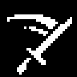

<p align="center">
  
</p>

<h1 align="center">Swing</h1>

<p align="center">
  <a href="https://www.minecraft.net"></a>
  <a href="https://fabricmc.net"></a>
  <a href="https://modrinth.com/mod/fabric-api"></a>
  <a href="https://adoptium.net"></a>
  <a href="https://gradle.org"></a>
  <a href="https://github.com/Flapjacck/swing/actions/workflows/build.yml"></a>
  <a href="LICENSE"></a>
</p>

Client-only Fabric mod for Minecraft 26.2. Tweaks your first-person viewmodel — item scale, swing speed, positional offsets, and tilt. Nothing server-side changes.

I made this because the usual "viewmodel" skyblock mods come packed with a pile of extra features I already get from other mods.

## Settings

Run `/swing` in game. A scrollable dark settings panel opens with sliders and number boxes for every value. Changes apply live, save to `config/swing.json` on close, and reload on next launch. All defaults are vanilla.

### Swing speed
- **Swing speed** (`1.00` = vanilla, lower is slower) — visual only, no server-side combat change
- **Ignore Haste** toggle — when ON, the animation ignores haste / mining fatigue so swing speed stays constant across gear sets and islands

### Held item scale
- **Held item scale** (`1.00` = vanilla) — scales the first-person item model
- **Apply Hand Scale** toggle — when ON, also scales the bare arm mesh when holding nothing

### Item offsets & tilt
- **Item X / Y / Z** — positional offset for the held item model (`-1.00` to `1.00`)
- **Item Pitch / Roll** — X and Z rotation for the held item (`-90` to `90°`)

### Arm offsets & tilt (requires Apply Hand Scale ON)
- **Arm X / Y / Z** — positional offset for the bare arm (`-1.00` to `1.00`)
- **Arm Pitch / Roll** — X and Z rotation for the bare arm (`-90` to `90°`)

Scaling and offsets do not apply in third person / F5.

## Build

Needs JDK 25.

```bash
./gradlew build
```

Use `build/libs/fabric-swing-1.5.0.jar`. Skip the `-sources` jar.

Dev launch:

```bash
./gradlew runClient
```

For Prism: Minecraft 26.2, Fabric Loader 0.19.5, Fabric API, then put the jar in that instance's `mods` folder.

Pinned versions: Fabric API 0.161.0+26.2, Loom 1.18.4, Gradle 9.7.1. Minecraft 26.x uses Mojang names, so there is no Yarn mappings line.

## License

CC0 1.0. Public domain. Copy it, fork it, ship it, sell it, whatever.
